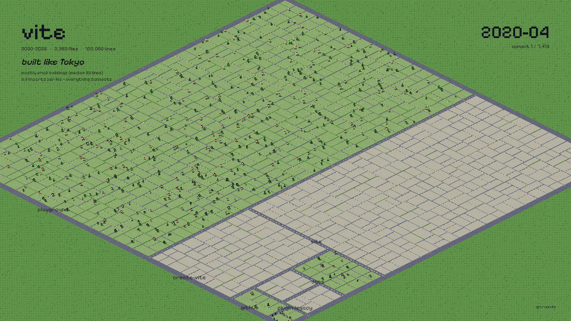
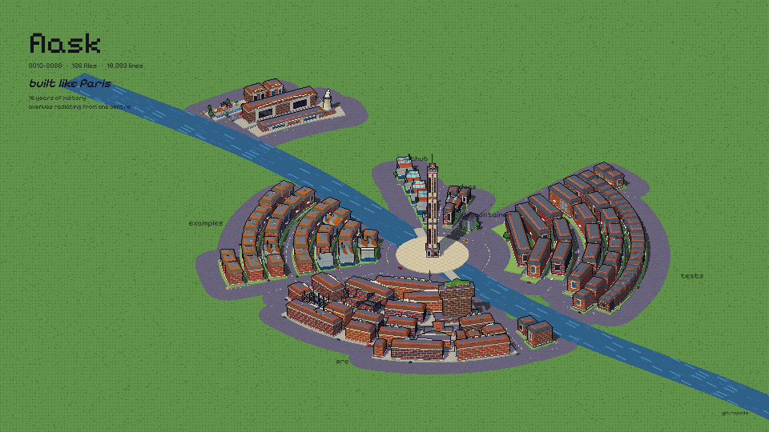
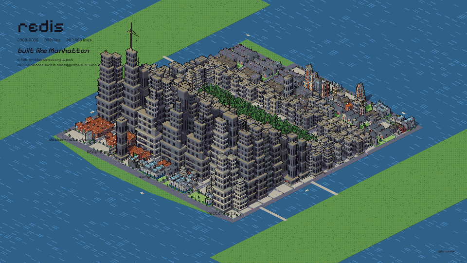
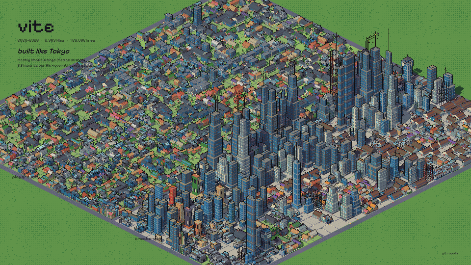
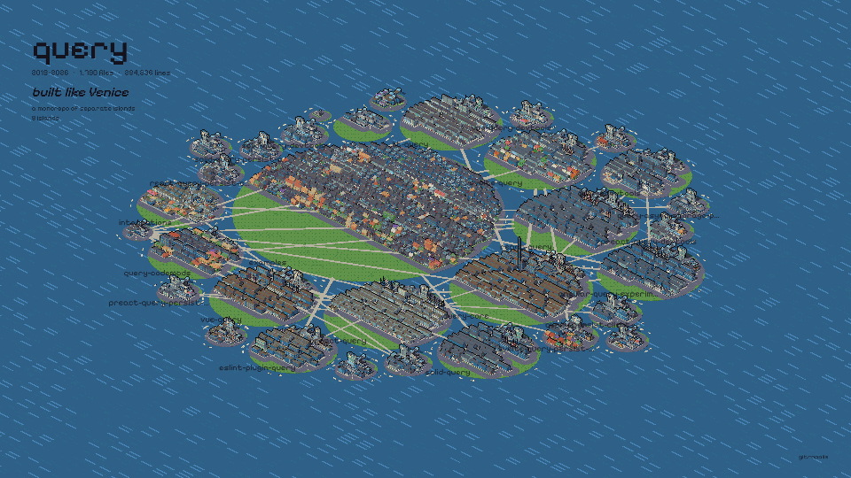
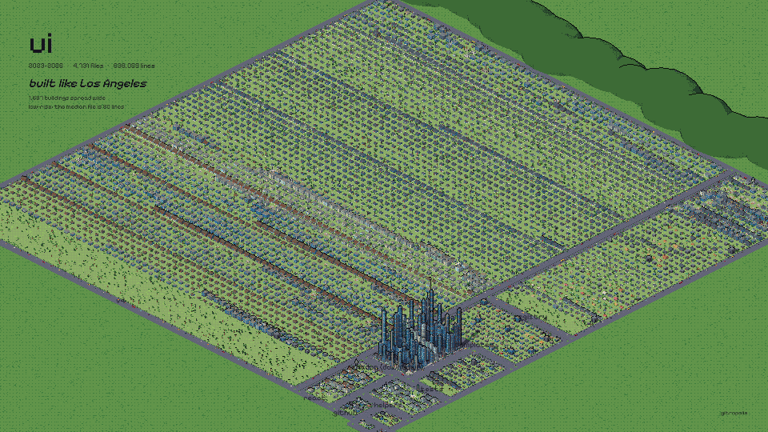
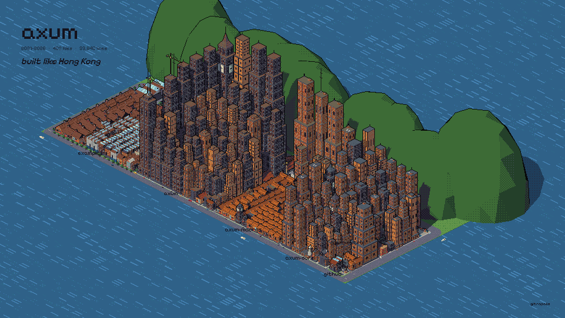
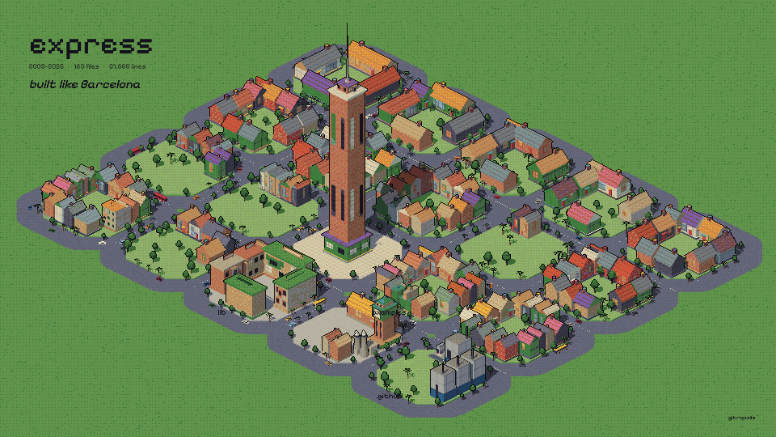
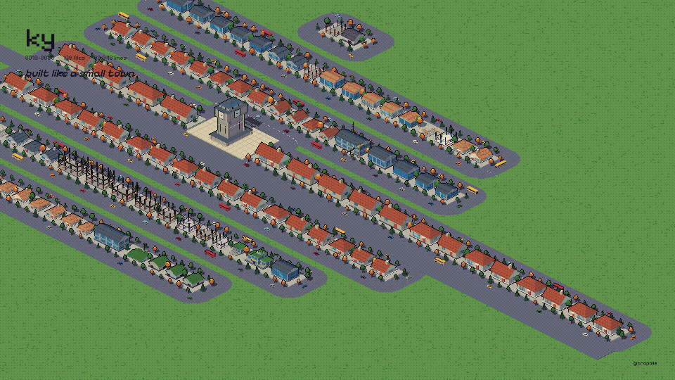
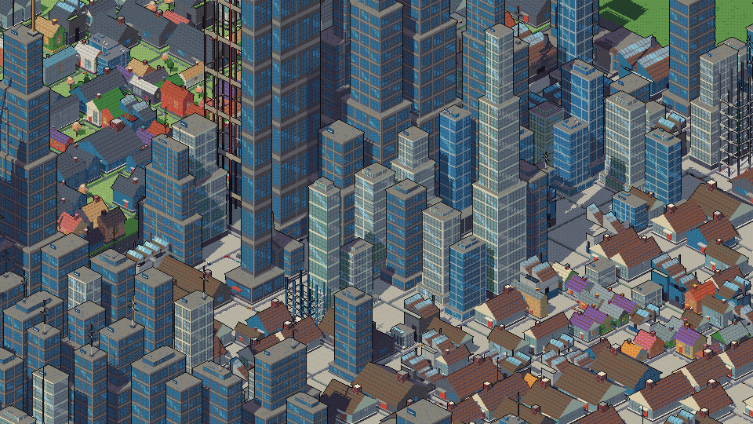

<div align="center">

# gitropolis

**Your git repo as a pixel-art city.**

Every file is a building. Every directory is a neighbourhood.<br>
Watch the city grow, commit by commit, from empty lots to a skyline.



<sub>vite, 2,383 files and 7,419 commits, played back in 10 seconds.</sub>

</div>

## Quick start

```bash
npx gitropolis /path/to/your/repo
```

Your browser opens on the city. There's nothing to install or build and no dependencies; you only need Node 18+ and git.

## Every repo gets its own city

gitropolis reads the shape of your code and picks a plan to match it. A big monorepo of separate packages becomes islands in a lagoon. Deep, tightly imported trees become dense wards. Old projects with one famous centre get avenues radiating from it.

<table>
<tr>
<td><br><b>Paris</b>: flask. Many years of history, buildings of even height, avenues around one centre, a river through town.</td>
<td><br><b>Manhattan</b>: redis. A flat, gridded layout, with most of the code in a few huge towers and a park in the middle.</td>
</tr>
<tr>
<td><br><b>Tokyo</b>: vite. Thousands of small buildings, wards inside wards, and everything imports everything.</td>
<td><br><b>Venice</b>: TanStack Query. A monorepo of packages that rarely import each other, so each one is its own island.</td>
</tr>
<tr>
<td><br><b>Los Angeles</b>: shadcn/ui. Low-rise and spread wide, with almost no imports, so everyone drives alone.</td>
<td><br><b>Hong Kong</b>: axum <sup>*</sup>. Long files packed into crowded directories become towers on a harbour.</td>
</tr>
<tr>
<td><br><b>Barcelona</b>: express <sup>*</sup>. Directories of about the same size become a grid of identical blocks.</td>
<td><br><b>Small town</b>: ky <sup>*</sup>. One main street, with a clock tower for the most-imported file.</td>
</tr>
</table>

<sub><sup>*</sup> These were forced with `--city`; left to itself, gitropolis plans these repos as Paris and Manhattan. Any repo can be drawn as any city.</sub>

The terminal tells you why your repo got its plan:

```text
this repo is Tokyo: mostly small buildings (median 99 lines); 3.3 imports per file, so everything connects
```

Some repos also get a condition on top of their plan. A repo with no recent commits is a ghost town. One where most files haven't been touched in years is ancient ruins. A sudden rush of commits makes a boomtown, and a repo that's mostly tests is a garden city.

## How to read the city



| In the city | In your code |
|---|---|
| Footprint and height | lines of code |
| Building type | what the file does: source files are towers, slabs and setbacks; tests and docs are houses; configs and build scripts are sheds; type definitions are steel frames; index files are halls |
| Architectural era | when the file was born: old stone, mid-century, or new glass |
| Materials and roof | the language: Rust, Go, Python, TypeScript, C and others each build in their own vernacular |
| District colour | the directory; a neighbourhood is painted as one |
| The tallest spire | the most-imported file |
| City hall · courthouse · clock tower | README · LICENSE · CHANGELOG |
| Port · power plant · airport | lockfile · package manifest · deploy config |
| Crane on site | a file that's being edited heavily right now |
| Ruin | a file nobody has touched in over two years |
| Flash on a roof | touched by the commit now playing |

The live view lets you drag to pan and scroll to zoom. Hover a building to see its file, and click it to light up its imports. <kbd>Space</kbd> plays or pauses the history, and <kbd>Esc</kbd> clears the selection.

## Make a README film

```bash
npx gitropolis . --gif city.gif --static --duration 10
```

This films the city growing along its git history and writes a GIF that fits GitHub's 10 MB limit. Pixel art compresses well, so every GIF pixel is exactly one art pixel, with no blur. Drop `--static` and the camera dives into the busiest junction instead. Use `--video city.mp4` for an MP4, or `--still city.png` for a single frame.

Filming runs in headless Chrome, so it looks the same on every machine. It needs [ffmpeg](https://ffmpeg.org) and Chrome, Chromium, Edge or Brave.

## Options

| Option | Default | |
|---|---|---|
| `--city <plan>` | `auto` | `smalltown` `manhattan` `hongkong` `tokyo` `la` `paris` `venice` `barcelona` |
| `--style <look>` | `pixel` | `maquette` `plan` `nocturne` are smooth-shaded alternatives |
| `--pixel <n>` | `2` | size of one art pixel, in screen pixels |
| `--zoom <n>` | `1` | close-up factor; `3` frames the city centre |
| `--gif <file>` · `--video <file>` | | film the city's history |
| `--still <file>` | | one frame (`--shot hero\|aerial\|street\|plan`, `--no-hud`) |
| `--static` | | hold the establishing shot while filming |
| `--duration <s>` · `--fps <n>` · `--size <WxH>` | `20` · `30` · `1920x1080` | |
| `--max-mb <n>` | `9.5` | size cap for GIF and MP4 |
| `--headed` | | film in a visible browser tab |
| `--port <n>` · `--no-open` | `4173` | |
| `--out <file>` | | write the scanned city as JSON and exit |
| `--bench` | | print setup and frame timings |

## How it works

1. **Scan.** `git ls-files`, a regex import pass for JS/TS, Python, Go, Rust and C/C++ (including workspace packages), and a pass over `git log --numstat` that follows renames.
2. **Plan.** gitropolis measures the code: file sizes, directory depth, import density, how much the packages depend on each other, and the project's age. It scores each city archetype on these numbers and lays out the winner's streets, blocks, water and landmarks.
3. **Build.** Every file gets a procedural building. Thousands of them merge into one mesh, so even an 8,600-file repo like svelte keeps a full frame rate.
4. **Draw.** The lit scene renders at a fraction of screen resolution and is quantised to a fixed palette with ordered dithering. Silhouettes get ink outlines from the depth buffer, and the result is scaled up with hard pixels. Brick courses, roof tiles, glass and water are painted in art pixels, so they stay crisp at every zoom.

Streets come from a distance field around the blocks, and cars, buses and boats follow lanes that stay on land or water.

## Known limits

- Imports are found with regexes, not a parser, so some are missed.
- Three.js loads from a CDN, so the viewer needs an internet connection.
- The view is fixed at one isometric angle; rotation is planned.

## License

MIT
