<div align="center">

# gitropolis

**Your git repo as a pixel-art city.**

Every file is a building. Every directory is a neighbourhood.<br>
Watch the city grow, commit by commit, from empty lots to a skyline.

**[gitropolis.dev](https://gitropolis.dev)** for any public repo · `npx gitropolis` for your own


<sub>vite, 2,383 files and 7,419 commits, played back in 10 seconds.</sub>

</div>

## Quick start

**In your browser**, for any public GitHub repo: swap `github.com` for `gitropolis.dev`.

```text
https://github.com/pallets/flask   →   https://gitropolis.dev/pallets/flask
```

The first visit surveys the repo (a minute at most), and the city is kept for everyone after that.

**On your machine**, for any repo, private ones included:

```bash
npx gitropolis /path/to/your/repo
```

Your browser opens on the city. There's nothing to install or build and no dependencies; you only need Node 18+ and git. Nothing leaves your machine.

## Every repo gets its own city

gitropolis reads the shape of your code and picks a plan to match it. A big monorepo of separate packages becomes islands in a lagoon. Deep, tightly imported trees become dense wards. Old projects with one famous centre get avenues radiating from it.

<p>
 
</p>

- **Paris** (left): flask. Many years of history, buildings of even height, avenues around one centre, a river through town.
- **Manhattan** (right): redis. A flat, gridded layout, with most of the code in a few huge towers and a park in the middle.

<p>
 
</p>

- **Tokyo** (left): vite. Thousands of small buildings, wards inside wards, and everything imports everything.
- **Venice** (right): TanStack Query. A monorepo of packages that rarely import each other, so each one is its own island.

<p>
 
</p>

- **Los Angeles** (left): shadcn/ui. Low-rise and spread wide, with almost no imports, so everyone drives alone.
- **Hong Kong** (right): axum <sup>*</sup>. Long files packed into crowded directories become towers on a harbour.

<p>
 
</p>

- **Barcelona** (left): express <sup>*</sup>. Directories of about the same size become a grid of identical blocks.
- **Small town** (right): ky <sup>*</sup>. One main street, with a clock tower for the most-imported file.

<p>
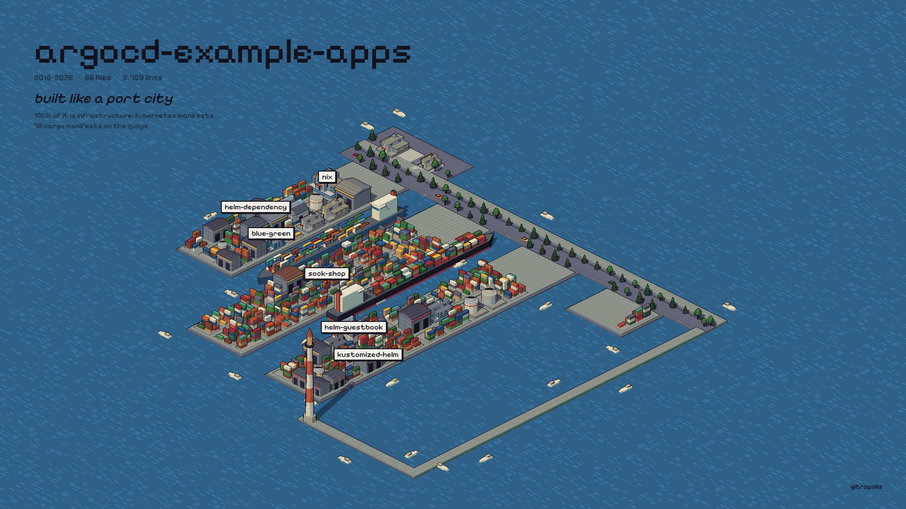 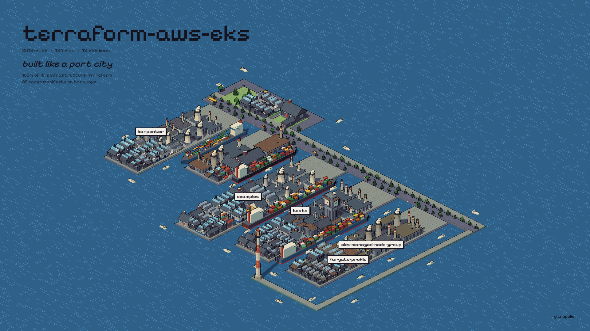
</p>

- **Port city** (left): argocd-example-apps. A repo of infrastructure, not code. Kubernetes manifests are container yards on the piers, with ships moored between them.
- **Port city** (right): terraform-aws-eks. Terraform modules become factories and power plants, and the module everything points at is the lighthouse.

<p>
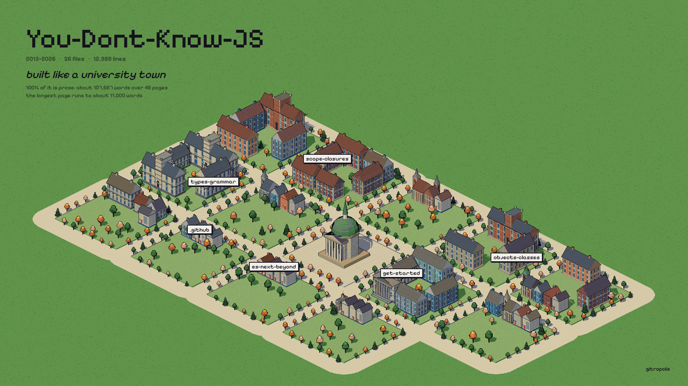 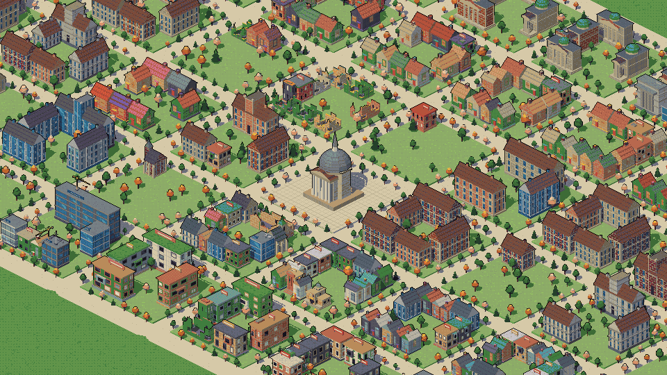
</p>

- **University town** (left): You Don't Know JS. A book, not code. Each directory is a quad of colleges round a lawn, with footpaths between them and the library in the middle.
- **University town** (right): the Vue docs, close up. Guides are brick colleges, API pages are domed halls, and the site's own components are a small town on the edge.

<p>
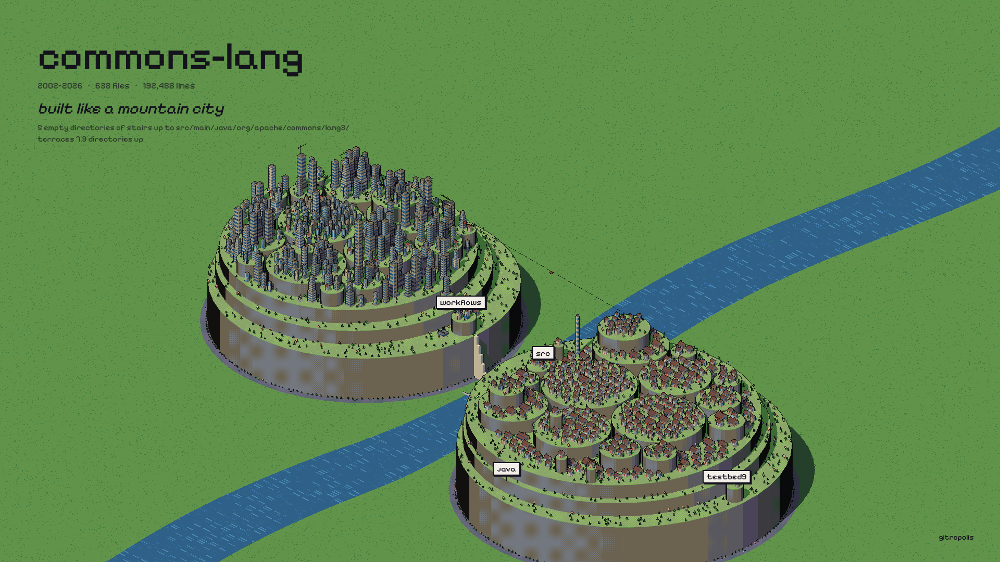 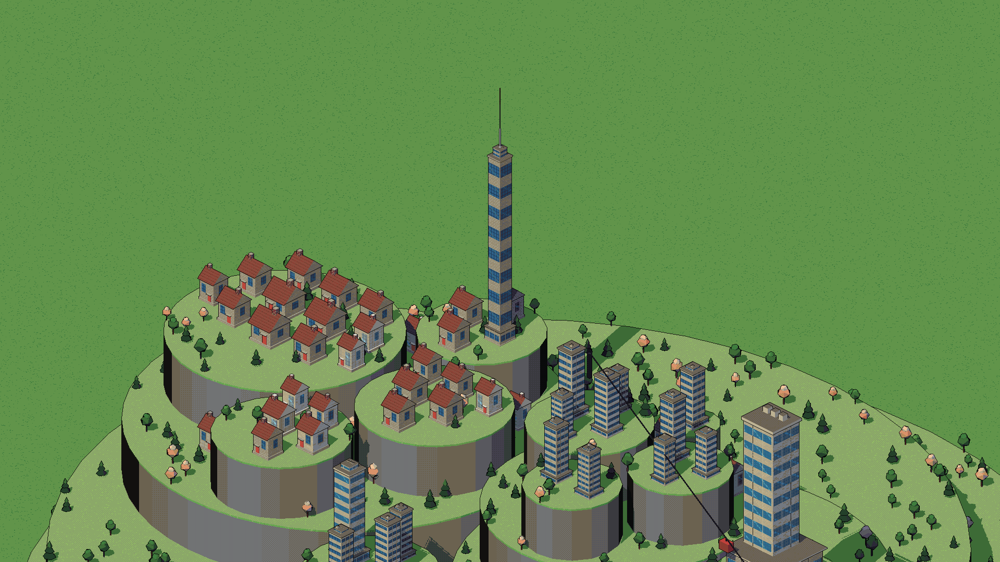
</p>

- **Mountain city** (left): Apache Commons Lang. Java's deep packages become terraced mountains, one terrace per package. The main code and the tests face each other across a river, with a cable car between their peaks.
- **Mountain city** (right): Spring PetClinic, close up. The empty directories on the way down to `src/main/java/org/springframework/samples/petclinic` are a stone stairway, one step each, up from the river.

<p>
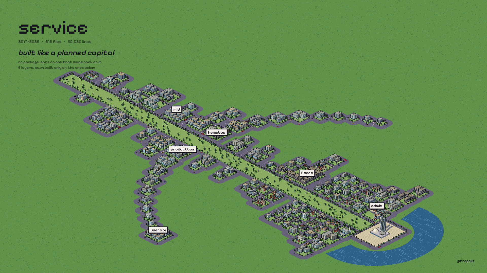 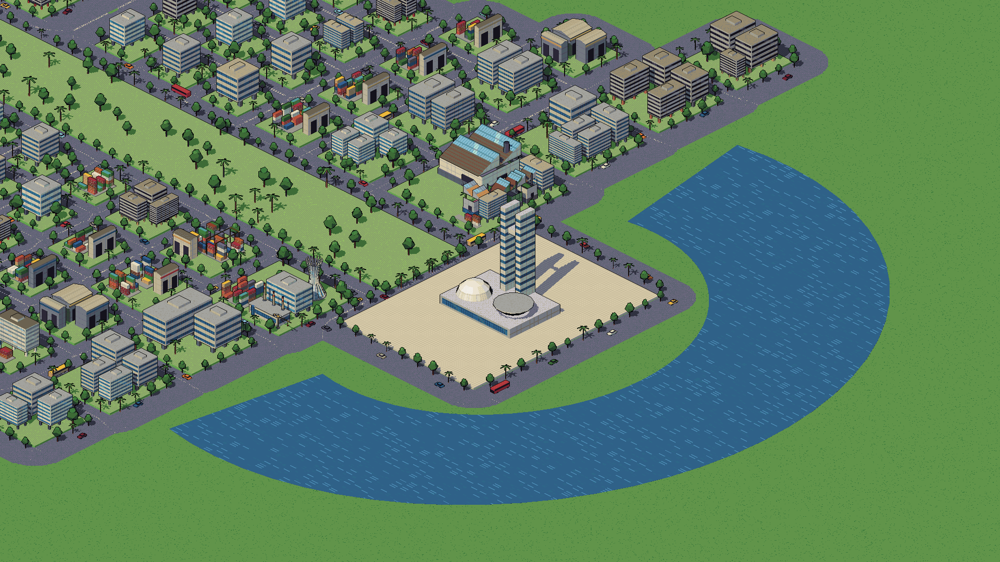
</p>

- **Planned capital** (left): ardanlabs/service. A strictly layered design: no package depends on one that depends back on it. The foundation layer stands at the head of a monumental axis by a lake, each layer above steps back down the axis, and the biggest layer sweeps out as two wings.
- **Planned capital** (right), close up. The most-depended-on file is the congress, the file that imports the most is the cathedral, and everything else is a white slab on columns in a green superblock.

<p>
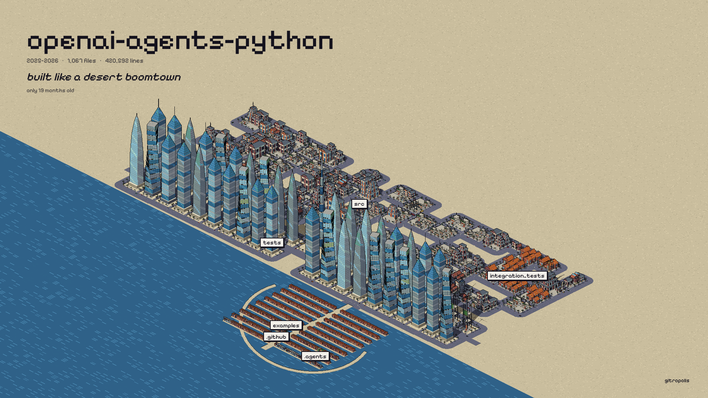 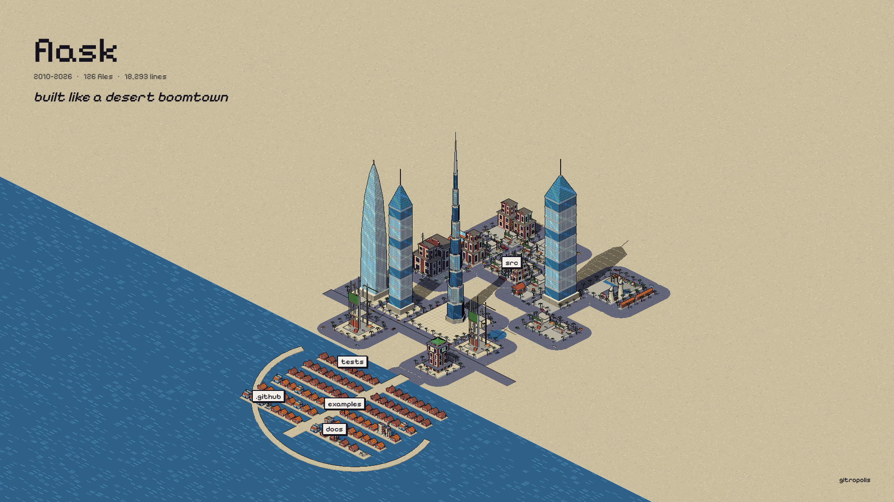
</p>

- **Desert boomtown** (left): openai-agents-python. A big city out of nothing in under two years. The biggest files are supertalls along the coast highway, the newest ones are still cranes, and the tests live in villas on a palm island.
- **Desert boomtown** (right): flask <sup>*</sup>, drawn small enough to see every piece. The needle is the most-depended-on file, with twisting, sail and crowned towers, empty plots of sand, and the palm with its crescent.

<p>
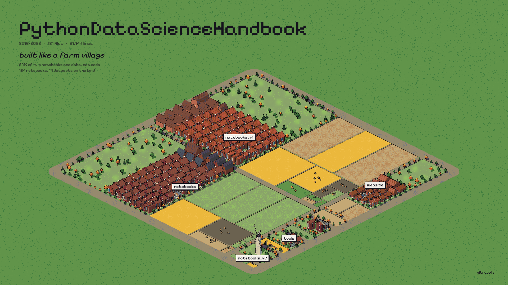 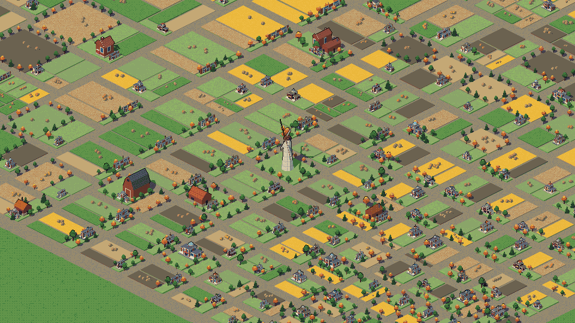
</p>

- **Farm village** (left): Python Data Science Handbook. Notebooks and data, not code. Notebooks are farmhouses (the biggest are barns), datasets are crop fields sized by their data, and a windmill stands on the village green.
- **Farm village** (right): FiveThirtyEight's data, close up. 635 datasets make a patchwork of fields, each a different crop with its furrows running one way or the other, and hay bales on it.

<sub><sup>*</sup> These were forced with `--city`; left to itself, gitropolis plans these repos as Paris and Manhattan. Any repo can be drawn as any city.</sub>

The terminal tells you why your repo got its plan:

```text
this repo is Tokyo: mostly small buildings (median 99 lines); 3.3 imports per file, so everything connects
```

Some repos also get a condition on top of their plan. A repo with no recent commits is a ghost town. One where most files haven't been touched in years is ancient ruins. A sudden rush of commits makes a boomtown, and a repo that's mostly tests is a garden city.

## How to read the city


| In the city | In your code |
|---|---|
| Footprint and height | lines of code |
| Building type | what the file does: source files are towers, slabs and setbacks; tests and docs are houses; configs and build scripts are sheds; type definitions are steel frames; index files are halls |
| Architectural era | when the file was born: old stone, mid-century, or new glass |
| Materials and roof | the language: Rust, Go, Python, TypeScript, C and others each build in their own vernacular |
| District colour | the directory; a neighbourhood is painted as one |
| Signpost | a folder's name, planted in the middle of its district |
| The tallest spire | the most-imported file |
| City hall · courthouse · clock tower | README · LICENSE · CHANGELOG |
| Port · power plant · airport | lockfile · package manifest · deploy config |
| Field · farmhouse · barn · silo · windmill | a dataset · a notebook · a big notebook · model weights · the most-imported file |
| Supertall · needle · crane · palm villa | one of the biggest files · the most-depended-on file · a file born in the last stretch · a test or doc |
| Axis · superblock · congress · cathedral | a layer of the design · a package · the most-depended-on file · the file that imports the most |
| Terrace · stairway | a package (subpackages are higher terraces) · the empty directories a path climbs through |
| College · chapel · library | docs and books: a page · a table of contents · the most-linked page |
| Container yard · warehouse · tank farm · factory | infrastructure as code: Kubernetes manifests · Helm, Kustomize and Ansible · jsonnet and Nix · Terraform |
| Crane on site | a file that's being edited heavily right now |
| Ruin | a file nobody has touched in over two years |
| Flash on a roof | touched by the commit now playing |

Drag to pan and scroll to zoom. The biggest districts carry signposts with their folder's name, and more appear as you zoom in. Hover a building to see its file and light up its whole district, and click it to light up its imports. The timeline under the city shows how busy each stretch of history was: click or drag it to jump, <kbd>Space</kbd> plays or pauses, <kbd>←</kbd> <kbd>→</kbd> step. The signpost button (or <kbd>L</kbd>) hides the names for a clean view, and <kbd>Esc</kbd> clears the selection.

## Share your city

The **share** button makes something to post, drawn in your browser:

- **A card**: the finished city with its name, what it's built like and why, its history and its numbers. Landscape for X and LinkedIn, square, or a story; with the details, or full bleed with just a name tag. Every art pixel is a 2×2 block, so it stays sharp after a social network recompresses it.
- **A GIF or a video** of the city growing: a GIF of about 800 pixels that fits in a chat, or an MP4 in 1080p, square or vertical.
- **A README badge**, in three looks, with the Markdown to copy:

  [](https://gitropolis.dev/pallets/flask) &nbsp; [](https://gitropolis.dev/pallets/flask) &nbsp; [](https://gitropolis.dev/pallets/flask)

  ```markdown
  [](https://gitropolis.dev/OWNER/REPO)
  ```

A `gitropolis.dev/owner/repo` link shows its city's card when you paste it into X, Slack, Discord or LinkedIn.

## Make a film from the command line

```bash
npx gitropolis . --gif city.gif --static --duration 10
```

This films the city growing along its git history and writes a GIF that fits GitHub's 10 MB limit. Pixel art compresses well, and every GIF pixel is a whole art pixel, so nothing is blurred. Drop `--static` and the camera dives into the busiest junction instead. Use `--video city.mp4` for an MP4, `--still city.png` for a single frame, or `--card card.png` for a share card with the repo's name and what city it's built like.

Filming runs in headless Chrome, so it looks the same on every machine. It needs [ffmpeg](https://ffmpeg.org) and Chrome, Chromium, Edge or Brave.

## Options

| Option | Default | |
|---|---|---|
| `--city <plan>` | `auto` | `farm` `desert` `capital` `mountain` `university` `port` `smalltown` `manhattan` `hongkong` `tokyo` `la` `paris` `venice` `barcelona` |
| `--style <look>` | `pixel` | `maquette` `plan` `nocturne` are smooth-shaded alternatives |
| `--pixel <n>` | `1` | size of one art pixel, in screen pixels (`2` for chunkier art) |
| `--zoom <n>` | `1` | close-up factor; `3` frames the city centre |
| `--gif <file>` · `--video <file>` | | film the city's history |
| `--still <file>` | | one frame (`--shot hero\|aerial\|street\|plan`, `--no-hud`) |
| `--card <file>` | | a share card PNG (`--shape landscape\|square\|story`, `--full` for full bleed) |
| `--static` | | hold the establishing shot while filming |
| `--duration <s>` · `--fps <n>` · `--size <WxH>` | `20` · `30` · `1920x1080` | |
| `--max-mb <n>` | `9.5` | size cap for GIF and MP4 |
| `--headed` | | film in a visible browser tab |
| `--port <n>` · `--no-open` | `4173` | |
| `--out <file>` | | write the scanned city as JSON and exit |
| `--bench` | | print setup and frame timings |

## How it works

1. **Scan.** `git ls-files`, a regex import pass for JS/TS, Python, Go, Rust, Java, Kotlin and C/C++ (including workspace packages), and a pass over `git log --numstat` that follows renames. Infrastructure as code is read too, when a repo has enough of it: Terraform module sources, jsonnet imports, Kustomize resources, Helm values and Ansible roles all count as links. So does prose in a docs site or a book: Markdown links between pages. Notebooks are read cell by cell (their imports count too), and datasets and model weights by their size.
2. **Plan.** gitropolis measures the code: file sizes, directory depth, import density, how much the packages depend on each other, and the project's age. It scores each city archetype on these numbers and lays out the winner's streets, blocks, water and landmarks.
3. **Build.** Every file gets a procedural building. Thousands of them merge into one mesh, so even an 8,600-file repo like svelte keeps a full frame rate.
4. **Draw.** The lit scene renders at a fraction of screen resolution and is quantised to a fixed palette with ordered dithering. Silhouettes get ink outlines from the depth buffer, and the result is scaled up with hard pixels. Brick courses, roof tiles, glass and water are painted in art pixels, so they stay crisp at every zoom.

Streets come from a distance field around the blocks, and cars, buses and boats follow lanes that stay on land or water.

## Known limits

- Imports are found with regexes, not a parser, so some are missed.
- The viewer's fonts come from Google Fonts; offline, the city still builds (three.js and d3-hierarchy ship in `web/vendor`) and the captions fall back to system fonts.
- The view is fixed at one isometric angle; rotation is planned.
- gitropolis.dev draws public repos up to 600 MB; for anything else, run `npx gitropolis` on your own copy.

## The hosted site

gitropolis.dev is this repo's `web/` folder on Cloudflare: a Worker in front, a few containers that clone and scan, and R2 keeping every city by commit. It's all in [`deploy/cloudflare`](deploy/cloudflare).

## Contributing

Bug reports, repos that come out looking wrong, and ideas for new city types are all welcome. See [CONTRIBUTING.md](CONTRIBUTING.md) for running gitropolis from a checkout and checking a change.

## License

MIT
